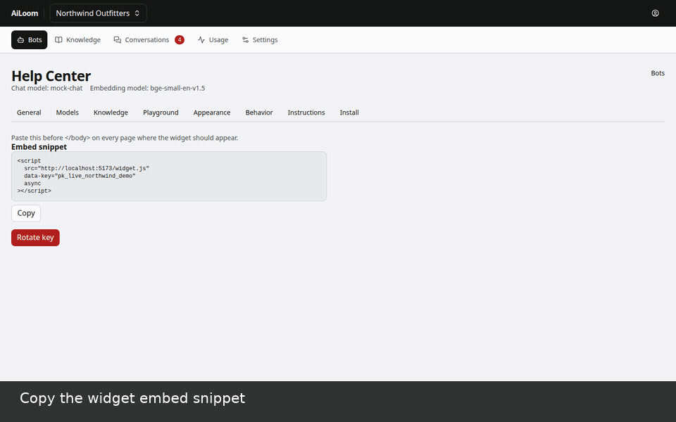
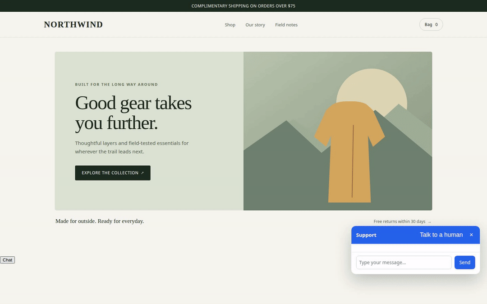
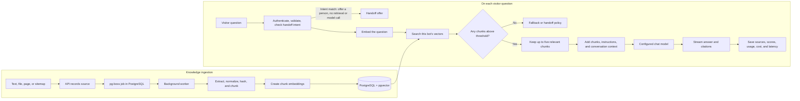
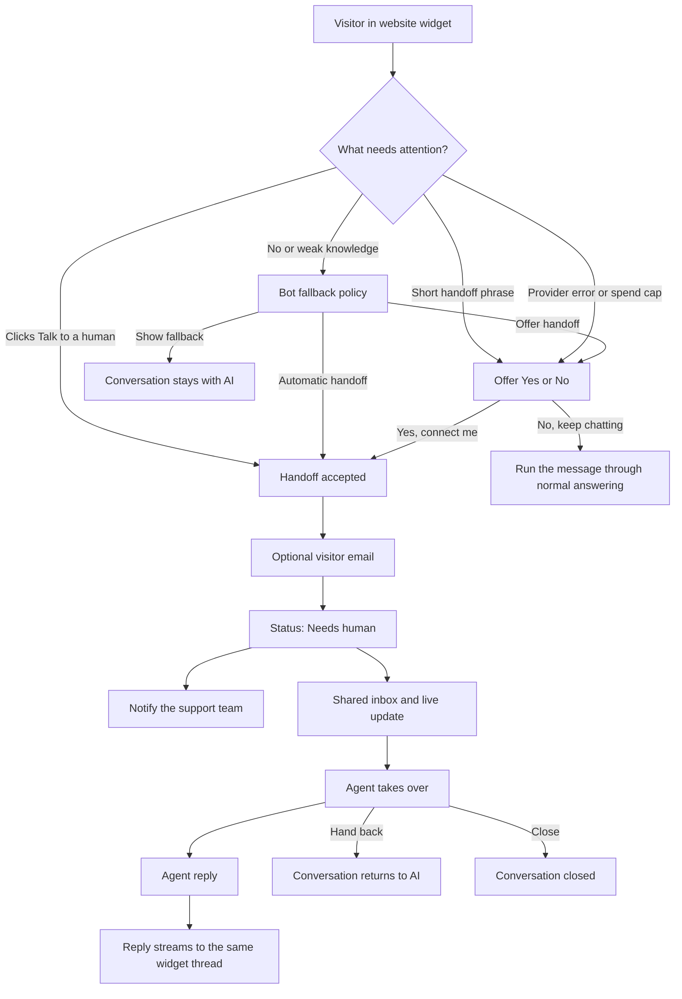
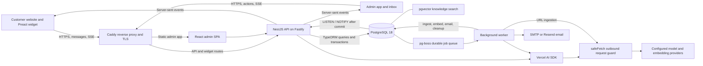

# AiLoom

[](https://github.com/li4nee/ailoom/actions/workflows/ci.yml)
[](LICENSE)
[](LICENSING.md)
[](LICENSING.md)
[](#project-status)

**Self-hosted AI customer support, with people in the loop.**

AiLoom gives customers a chat widget that answers from your knowledge, hands off when it
needs a person, and gives your team one place to resolve conversations. Every answer can be
reviewed against its retrieved sources, model usage, cost, and latency. Run the whole stack
on your own infrastructure and choose your model provider.

[Get started](https://li4nee.github.io/ailoom/getting-started/) ·
[Read the docs](https://li4nee.github.io/ailoom/) ·
[Contribute](CONTRIBUTING.md)

## Product tour

These short screen tours were captured in a local browser using the seeded Northwind demo
workspace.

### Admin workspace


### Website widget

Add the generated script tag to your site, then customers can ask questions without leaving
the page. When the bot cannot find a reliable answer, it explains that and offers a human
instead of guessing.



### Human handoff

When the bot cannot confidently help, or a visitor asks for a person, AiLoom moves the
conversation into the team's inbox. The agent takes over and replies in the same widget thread.



## What you can do

- **Build knowledge-grounded bots.** Add text, files, or crawled pages. Test retrieval and
  inspect the chunks and scores before you publish.
- **Let people take over.** Route conversations that need attention to a shared inbox. Agents
  can assign, prioritize, reply, add private notes, and use reviewed AI suggestions.
- **Understand each answer.** Open a trace to review the retrieved context, model request,
  token usage, cost, latency, and outcome.
- **Improve the knowledge base.** Usage, unanswered-question, and negative-feedback reports
  reveal where answers need attention.
- **Choose how AI runs.** Connect OpenAI, Anthropic, Gemini, Groq, Mistral, Ollama, or another
  OpenAI-compatible provider. AiLoom also includes a local embedding model.
- **Keep the stack small.** The Compose deployment uses Caddy, the API and background worker,
  and PostgreSQL with pgvector. It does not require a separate Redis or vector database.

## How RAG works in AiLoom

Retrieval-augmented generation (RAG) lets the bot answer from your own support content. AiLoom
does not train or fine-tune the model on your documents. It finds relevant passages for each
question and includes those passages as context in that answer's model request.

### Prepare the knowledge base once

Add text, upload a file, or crawl a page or sitemap. The API saves the source and queues work
in **pg-boss**, which stores its jobs in PostgreSQL. The background worker extracts readable
text, normalizes it, skips unchanged content, splits it into structure-aware chunks, and
creates an embedding for each chunk. Chunking follows headings, paragraphs, and sentences;
chunks target about 400 tokens, with a 700-token maximum and 60-token overlap. AiLoom stores
the chunks, source references, and vectors in PostgreSQL with **pgvector**. Source status
updates appear in the admin app as ingestion finishes.

### Retrieve context for each question

The API embeds the visitor's question with the bot's configured embedding model and searches
only that bot's current knowledge, workspace, and embedding model. It retrieves up to eight
nearby chunks, then adds up to five chunks that meet the bot's relevance threshold to the
prompt, alongside the bot instructions and recent conversation history. The selected chat
model streams an answer to the widget with source citations. AiLoom stores a trace with the
retrieved sources, scores, model, token usage, cost, and latency so the team can inspect why
the bot answered as it did.



The detailed [ingestion pipeline](docs/assets/ingestion-pipeline.svg) and
[chat pipeline](docs/assets/chat-pipeline.svg) show the implementation steps. Operators can
use **Test retrieval** to inspect matching chunks and scores before publishing a bot.

## How human handoff works

Handoff can start when a visitor clicks **Talk to a human**, accepts an offer, or the bot's
configured no-answer behavior automatically routes a conversation to an agent. A short,
multi-word request such as “talk to a human” only offers the choice; it never silently takes
the conversation away. If the visitor declines, AiLoom retries the same message through the
normal answer flow. For missing or weak knowledge, the bot can show a fallback, offer a
handoff, or hand off automatically. Provider errors and a reached spend cap show a handoff
offer.

Once the visitor confirms, AiLoom can collect an optional email, marks the conversation
**Needs human**, and stops bot replies in that thread. The team sees it in the shared inbox
and can receive an email and an opt-in browser notification. An agent takes over, replies in
the inbox, and the message appears in the visitor's widget in real time. The agent can later
hand the conversation back to AI or close it.



## How the system is orchestrated



The tools each have a focused role:

- **Caddy** is the public HTTPS entry point and routes the admin app, API, and widget.
- **NestJS with Fastify** handles authentication, workspace boundaries, chat and handoff
  decisions, and API requests.
- **PostgreSQL 18** stores application data, conversation state, traces, and knowledge. Its
  **pgvector** extension stores and searches embeddings; **pg-boss** uses the same database
  for background jobs, so a separate Redis or vector database is not required.
- **The worker** handles slower work outside the visitor request: crawling and ingesting
  knowledge, embedding chunks, sending email, and scheduled cleanup.
- **The Vercel AI SDK** connects the API and worker to the selected chat and embedding
  providers. The built-in local embedding model and optional Ollama are also supported.
- **PostgreSQL LISTEN/NOTIFY and server-sent events (SSE)** keep open inboxes and widget
  conversations up to date without a separate message broker.
- **safeFetch** guards outbound requests to model providers and crawled websites.

The [architecture guide](docs/architecture.md) has the module map, request lifecycle,
database details, and security boundaries.

## Run AiLoom with Docker Compose

You need Docker Engine with Compose v2, Node.js 24, and pnpm 12. Node and pnpm install the
dependencies and generate instance secrets; Docker Compose runs the application.

```bash
git clone https://github.com/li4nee/ailoom.git
cd ailoom
cp .env.example .env
pnpm install --frozen-lockfile
pnpm secrets:generate
```

Paste the generated secret values into `.env`. For a local HTTP deployment, set these values
there as well:

```dotenv
PUBLIC_URL=http://localhost:8080
HTTP_PORT=8080
POSTGRES_USER=ailoom
POSTGRES_PASSWORD=replace-with-a-long-url-safe-password
POSTGRES_DB=ailoom
```

Start the stack:

```bash
docker compose -f deploy/docker-compose.yml --env-file .env up -d --build --wait
```

Open [http://localhost:8080](http://localhost:8080) and create the first account. The first
signup becomes the instance administrator. Then create a workspace, add a bot and provider
credential, add a knowledge source, and test a question in the playground. Copy the snippet
from the bot's **Install** tab to add the widget to your site.

For production, configure a public HTTPS URL, email delivery, backups, and the desired signup
policy. Follow the full [self-hosting guide](https://li4nee.github.io/ailoom/self-hosting/)
and review [configuration](https://li4nee.github.io/ailoom/configuration/) before exposing
an instance to the internet.

## Develop locally

For local development, install dependencies and start the development database and mail
viewer:

```bash
pnpm install
cp .env.example .env
pnpm secrets:generate
docker compose -f deploy/docker-compose.dev.yml up -d
pnpm db:migrate
pnpm dev
```

The development database listens on port `55432`; Mailpit is included for viewing test
emails at [http://localhost:8025](http://localhost:8025). `pnpm dev` starts the API and admin
app. In a second terminal, start the background worker:

```bash
pnpm --filter @app/api dev:worker
```

Fetch the local embedding model before running integration tests that use it:

```bash
pnpm --filter @app/api fetch-model
```

Useful repository commands:

| Command          | Purpose                              |
| ---------------- | ------------------------------------ |
| `pnpm lint`      | Run lint checks across the workspace |
| `pnpm typecheck` | Type-check workspace packages        |
| `pnpm test`      | Run unit and integration test suites |
| `pnpm build`     | Build workspace packages and apps    |
| `pnpm e2e`       | Run browser end-to-end tests         |

See [Contributing](CONTRIBUTING.md) for commit sign-off, code review, and contribution
guidelines.

## Documentation

- [Getting started](https://li4nee.github.io/ailoom/getting-started/) and
  [self-hosting](https://li4nee.github.io/ailoom/self-hosting/)
- [Architecture](docs/architecture.md) and [technical specification](docs/spec.md)
- [Widget setup](https://li4nee.github.io/ailoom/widget/) and
  [model providers](https://li4nee.github.io/ailoom/providers/)
- [Integrations](https://li4nee.github.io/ailoom/integrations/),
  [backups](https://li4nee.github.io/ailoom/backups/), and
  [upgrades](https://li4nee.github.io/ailoom/upgrades/)
- [Data handling](https://li4nee.github.io/ailoom/data-handling/) explains what the self-hosted
  instance stores, sends to configured providers, and retains.
- [Security policy](SECURITY.md), [support](SUPPORT.md), and [governance](GOVERNANCE.md)

## Project status

AiLoom is in public beta and has not reached 1.0. APIs, configuration, and the database
schema may change between `0.x` releases. Read the [upgrade notes](https://li4nee.github.io/ailoom/upgrades/)
before upgrading. AiLoom is self-hosted, not a managed service: operators are responsible
for infrastructure, access control, backups, and their model providers' terms.

## License

Licensing depends on where the code runs:

- The API and admin app (`apps/api`, `apps/admin`) are **AGPL-3.0-only**.
- The widget and shared packages are **MIT**.
- Documentation is **CC-BY-4.0**.

Embedding the MIT-licensed widget in another product does not make that product AGPL. See
[LICENSING.md](LICENSING.md) for details.
