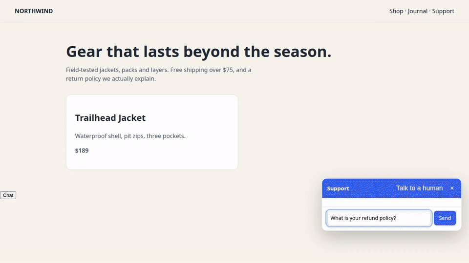
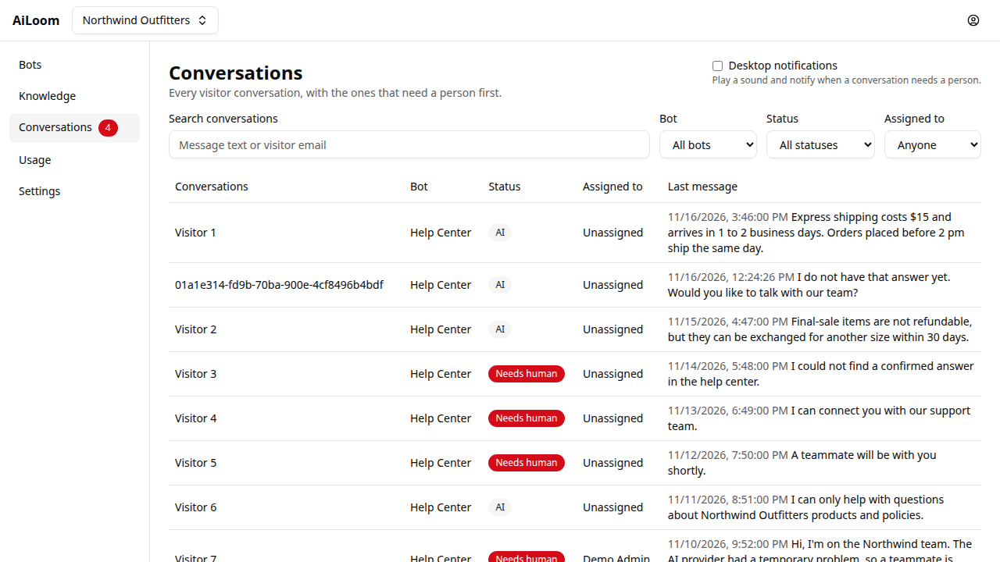
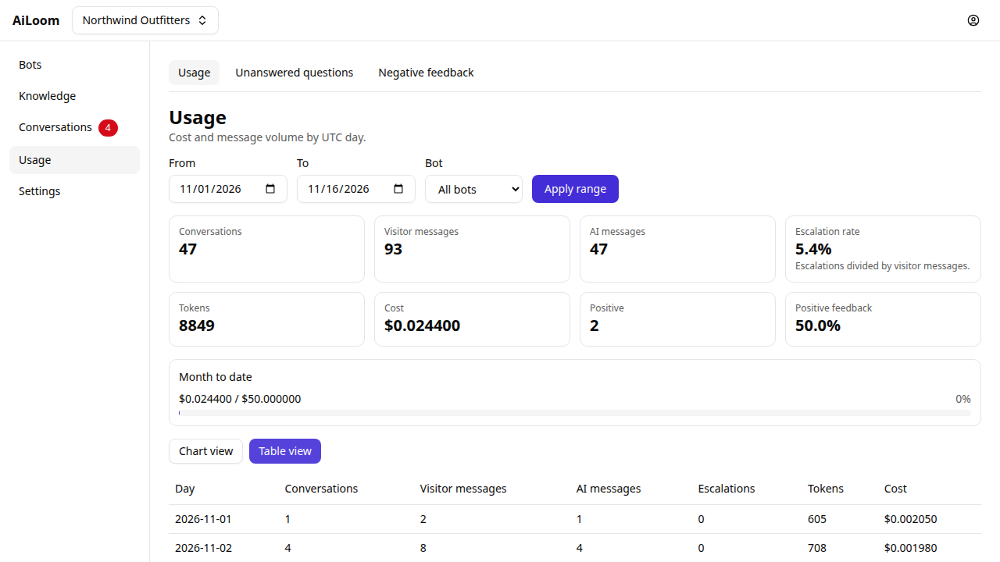

# ailoom

[](https://github.com/li4nee/ailoom/actions/workflows/ci.yml)
[](LICENSE)
[](LICENSING.md)
[](LICENSING.md)
[](#status)

**The easiest self-hosted AI support platform for developers to deploy, extend, and trust.**

An AI agent answers customers first, grounded in your own knowledge. It knows when to
escalate, and humans can step in, correct it, and improve it over time. Everything runs from
one `docker compose up`, with your own model keys or fully local models.



## Why this exists

Support tools either lock your data in a SaaS or leave you stitching together a widget, a
vector database, and a prompt. AiLoom is the whole loop in one deployable stack — and every
AI decision is inspectable.

## Differentiators

- **Answer replay.** Every AI answer opens to show exactly what the model saw, which sources
  it used, the scores, tokens, cost, latency, and time to first token.
- **Knowledge-gap analytics.** Unanswered and negatively rated questions are surfaced, so
  you know which documentation to write next.
- **Bring your own model.** OpenAI, Anthropic, Gemini, Groq, Mistral, Ollama, or any
  OpenAI-compatible endpoint. The built-in embedding model works with a single chat key.
- **Operable by one person.** One PostgreSQL database with pgvector, no Redis and no separate
  vector database.

## Quick start

On a host with Docker, Docker Compose, Node 24, and pnpm:

```bash
git clone https://github.com/li4nee/ailoom.git && cd ailoom
cp .env.example .env
pnpm secrets:generate        # paste the values into .env
docker compose -f deploy/docker-compose.yml --env-file .env up -d --build --wait
```

Open `PUBLIC_URL` (local default: `http://localhost:8080`), sign up, create a bot, add
knowledge, and copy the widget snippet. Full instructions:
**[Getting started](https://li4nee.github.io/ailoom/getting-started/)**.

## Screenshots

| Inbox                                      | Answer replay                                       |
| ------------------------------------------ | --------------------------------------------------- |
|  |  |

| Knowledge                                          | Usage                                      |
| -------------------------------------------------- | ------------------------------------------ |
|  |  |

## Documentation

- [Docs site](https://li4nee.github.io/ailoom/) — quick start, self-hosting, providers, widget,
  backups, upgrades, troubleshooting
- [Product and technical specification](docs/spec.md)
- [Architecture](docs/architecture.md)
- [Security policy](SECURITY.md)
- [Contributing](CONTRIBUTING.md) · [Governance](GOVERNANCE.md) · [Support](SUPPORT.md)

## Status

**Pre-1.0 and not production-ready yet.** APIs, configuration, and the database schema can
change between `0.x` releases. Breaking changes are listed under "Upgrade notes" in the
[changelog](CHANGELOG.md). The launch checklist and benchmark results are in `docs/`.

## Contributing

Read [CONTRIBUTING.md](CONTRIBUTING.md) for the development setup, test commands, and the
signed-commit requirement. Good first issues are labelled in GitHub Issues.

## License

ailoom is split by where the code runs:

- The server and admin app (`apps/api`, `apps/admin`) are **AGPL-3.0-only**.
- The widget and shared packages (`packages/*`) are **MIT**.
- Documentation content is **CC-BY-4.0**.

Embedding the widget in your own product never makes your product AGPL. See
[LICENSING.md](LICENSING.md) for details.
