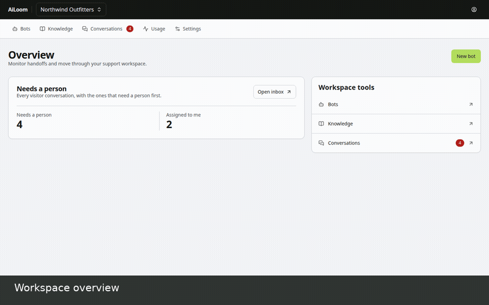
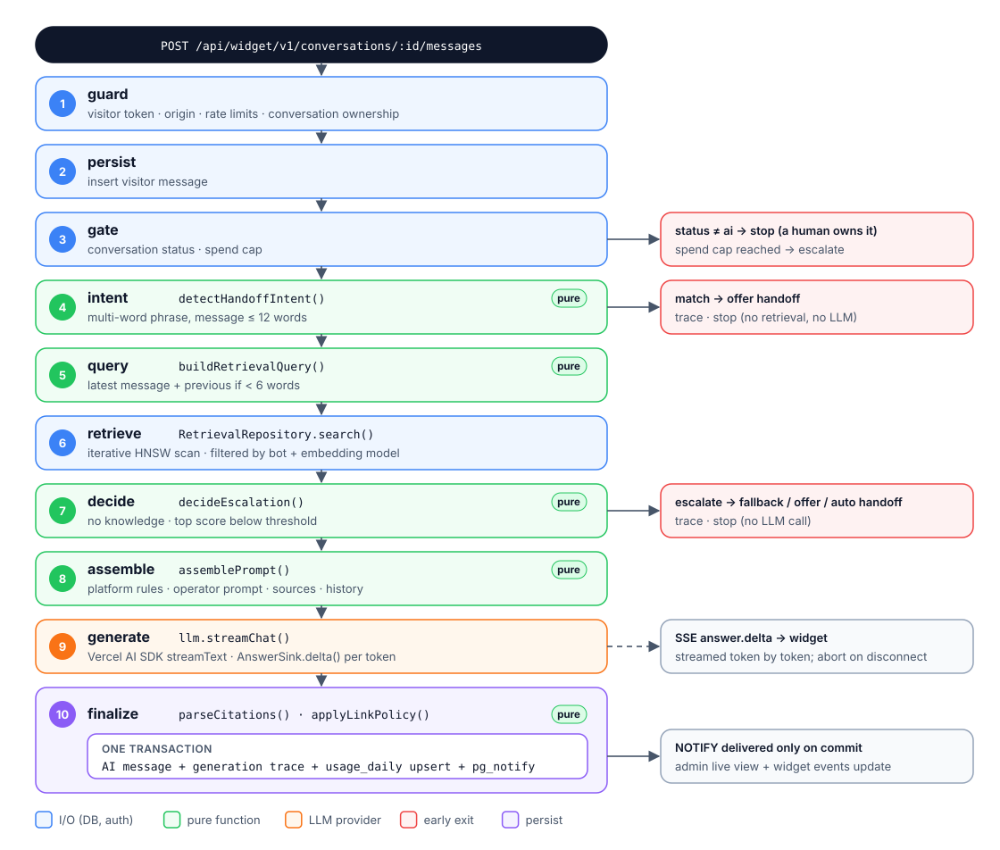

# AiLoom

[](https://github.com/li4nee/ailoom/actions/workflows/ci.yml)
[](LICENSE)
[](LICENSING.md)
[](LICENSING.md)
[](#project-status)

**Self-hosted AI customer support, with people in the loop.**

AiLoom gives customers a chat widget that answers from your knowledge, hands off when it
needs a person, and gives your team one place to resolve conversations. Every answer can be
reviewed against its retrieved sources, model usage, cost, and latency. Run the whole stack
on your own infrastructure and choose your model provider.

[Get started](https://li4nee.github.io/ailoom/getting-started/) ·
[Read the docs](https://li4nee.github.io/ailoom/) ·
[Contribute](CONTRIBUTING.md)

## Product tour

These short screen tours were captured in a local browser using the seeded Northwind demo
workspace.

### Admin workspace



### Website widget

Click **Copy snippet**, paste the generated script tag just before `</body>` in your page, and
the widget is ready. The recording shows that exact copy → paste → preview flow.


The earlier [visitor chat demo](docs/assets/demo.gif) shows a customer asking a question and
receiving an answer in the widget.

## What you can do

- **Build knowledge-grounded bots.** Add text, files, or crawled pages. Test retrieval and
  inspect the chunks and scores before you publish.
- **Let people take over.** Route conversations that need attention to a shared inbox. Agents
  can assign, prioritize, reply, add private notes, and use reviewed AI suggestions.
- **Understand each answer.** Open a trace to review the retrieved context, model request,
  token usage, cost, latency, and outcome.
- **Improve the knowledge base.** Usage, unanswered-question, and negative-feedback reports
  reveal where answers need attention.
- **Choose how AI runs.** Connect OpenAI, Anthropic, Gemini, Groq, Mistral, Ollama, or another
  OpenAI-compatible provider. AiLoom also includes a local embedding model.
- **Keep the stack small.** The Compose deployment uses Caddy, the API and background worker,
  and PostgreSQL with pgvector. It does not require a separate Redis or vector database.

## How it works



1. **Prepare a bot.** Choose a model, set its instructions and handoff behavior, and add
   allowed website origins.
2. **Add knowledge.** The API records each source and queues ingestion. A background worker
   reads and normalizes its content, splits it into chunks, creates embeddings, and stores
   them in PostgreSQL with pgvector.
3. **Answer a visitor.** The widget sends a message to the API. AiLoom checks the request,
   retrieves relevant chunks, and streams a model response with source references. If the
   request should go to a person, the conversation is marked for handoff instead.
4. **Work the conversation.** Agents see live updates in the inbox and can take over, reply,
   add a private note, or use an AI draft.
5. **Review and improve.** AiLoom saves the answer trace and usage details. Replay the answer,
   then use unanswered questions and feedback to improve the bot's knowledge.

The [architecture guide](docs/architecture.md) explains the API, worker, widget, database,
and event flow in more detail.

## Run AiLoom with Docker Compose

You need Docker Compose, Node.js 24, and pnpm. The Node and pnpm tools generate the instance
secrets; the app itself runs in Docker.

```bash
git clone https://github.com/li4nee/ailoom.git
cd ailoom
cp .env.example .env
pnpm install --frozen-lockfile
pnpm secrets:generate
```

Paste the generated secret values into `.env`. For a local HTTP deployment, set these values
there as well:

```dotenv
PUBLIC_URL=http://localhost:8080
HTTP_PORT=8080
POSTGRES_USER=ailoom
POSTGRES_PASSWORD=replace-with-a-long-url-safe-password
POSTGRES_DB=ailoom
```

Start the stack:

```bash
docker compose -f deploy/docker-compose.yml --env-file .env up -d --build --wait
```

Open [http://localhost:8080](http://localhost:8080) and create the first account. The first
signup becomes the instance administrator. Then create a workspace, add a bot and provider
credential, add a knowledge source, and test a question in the playground. Copy the snippet
from the bot's **Install** tab to add the widget to your site.

For production, configure a public HTTPS URL, email delivery, backups, and the desired signup
policy. Follow the full [self-hosting guide](https://li4nee.github.io/ailoom/self-hosting/)
and review [configuration](https://li4nee.github.io/ailoom/configuration/) before exposing
an instance to the internet.

## Develop locally

For local development, install dependencies and start the development database and mail
viewer:

```bash
pnpm install
cp .env.example .env
pnpm secrets:generate
docker compose -f deploy/docker-compose.dev.yml up -d
pnpm db:migrate
pnpm dev
```

The development database listens on port `55432`; Mailpit is included for viewing test
emails. Fetch the local embedding model before running integration tests that use it:

```bash
pnpm --filter @app/api fetch-model
```

Useful repository commands:

| Command          | Purpose                              |
| ---------------- | ------------------------------------ |
| `pnpm lint`      | Run lint checks across the workspace |
| `pnpm typecheck` | Type-check workspace packages        |
| `pnpm test`      | Run unit and integration test suites |
| `pnpm build`     | Build workspace packages and apps    |
| `pnpm e2e`       | Run browser end-to-end tests         |

See [Contributing](CONTRIBUTING.md) for commit sign-off, code review, and contribution
guidelines.

## Documentation

- [Getting started](https://li4nee.github.io/ailoom/getting-started/) and
  [self-hosting](https://li4nee.github.io/ailoom/self-hosting/)
- [Architecture](docs/architecture.md) and [technical specification](docs/spec.md)
- [Widget setup](https://li4nee.github.io/ailoom/widget/) and
  [model providers](https://li4nee.github.io/ailoom/providers/)
- [Integrations](https://li4nee.github.io/ailoom/integrations/),
  [backups](https://li4nee.github.io/ailoom/backups/), and
  [upgrades](https://li4nee.github.io/ailoom/upgrades/)
- [Security policy](SECURITY.md), [support](SUPPORT.md), and [governance](GOVERNANCE.md)

## Project status

AiLoom is in public beta and has not reached 1.0. APIs, configuration, and the database
schema may change between `0.x` releases. Read the [upgrade notes](https://li4nee.github.io/ailoom/upgrades/)
before upgrading. AiLoom is self-hosted, not a managed service: operators are responsible
for infrastructure, access control, backups, and their model providers' terms.

## License

Licensing depends on where the code runs:

- The API and admin app (`apps/api`, `apps/admin`) are **AGPL-3.0-only**.
- The widget and shared packages are **MIT**.
- Documentation is **CC-BY-4.0**.

Embedding the MIT-licensed widget in another product does not make that product AGPL. See
[LICENSING.md](LICENSING.md) for details.
