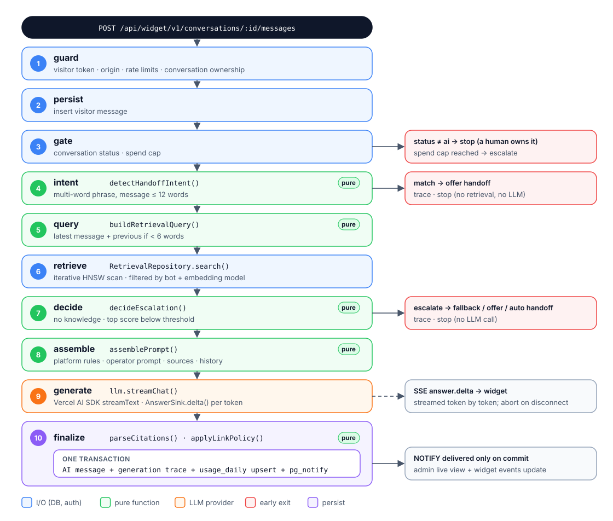
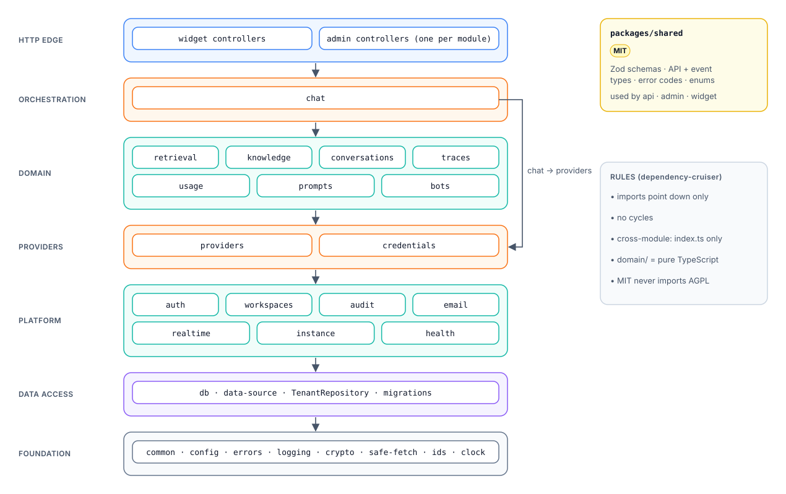
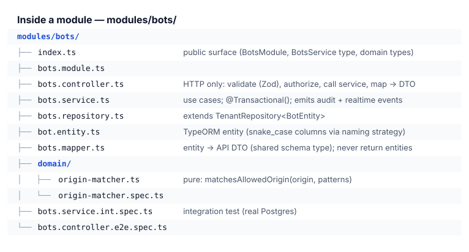
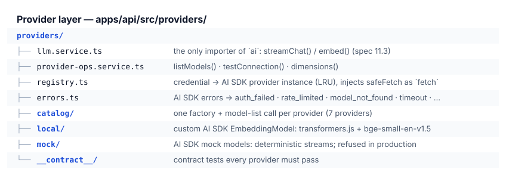
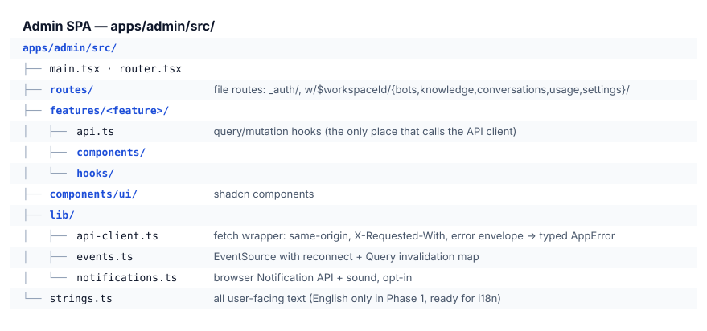
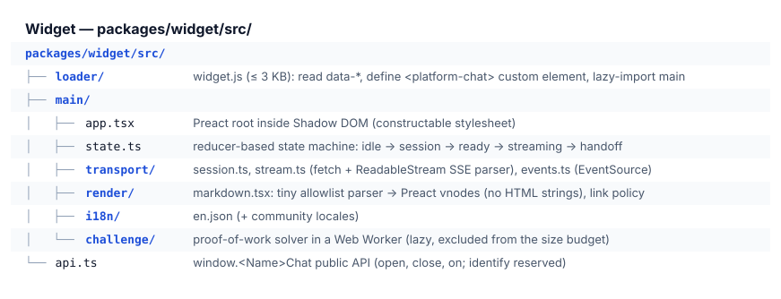
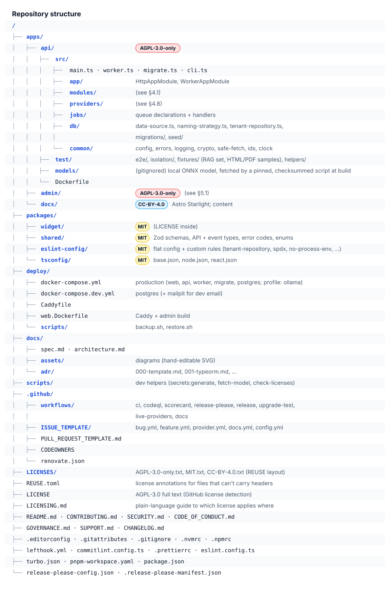

# Architecture, Engineering Standards & Build Plan — v1

> Companion to [`spec.md`](./spec.md). The spec says **what** the platform does; this document says **how** it is built, how the code is organized, the standards every change must meet, how the open-source project is run, and the order of work.
>
> Status: Draft · Applies to Phase 0 and Phase 1 in detail; later phases only where today's structure must leave room for them.

---

## Table of contents

1. [Reading guide](#1-reading-guide)
2. [Decisions in this revision](#2-decisions-in-this-revision)
3. [System architecture](#3-system-architecture)
4. [Backend architecture (api + worker)](#4-backend-architecture-api--worker)
5. [Frontend architecture (admin + widget)](#5-frontend-architecture-admin--widget)
6. [Repository and open-source structure](#6-repository-and-open-source-structure)
7. [Coding standards](#7-coding-standards)
8. [Contribution workflow, releases, governance](#8-contribution-workflow-releases-governance)
9. [Security engineering](#9-security-engineering)
10. [Testing and CI/CD](#10-testing-and-cicd)
11. [Build plan](#11-build-plan)
12. [Risks and mitigations](#12-risks-and-mitigations)
13. [Open items](#13-open-items)

---

## 1. Reading guide

- **New contributor:** read §3, §4.1–4.3, §6, §7, §8.
- **Reviewer:** §7 and §9 are the checklist you hold PRs to.
- **Maintainer planning work:** §11 and §12.
- Section numbers like "spec 13.1" refer to `spec.md`.

---

## 2. Decisions in this revision

| Topic             | Decision                                                                                                                                                                                                                                       | Why                                                                                                                                                                      |
| ----------------- | ---------------------------------------------------------------------------------------------------------------------------------------------------------------------------------------------------------------------------------------------- | ------------------------------------------------------------------------------------------------------------------------------------------------------------------------ |
| Runtime           | Node 24 LTS                                                                                                                                                                                                                                    | Node 20 reached end of life in April 2026                                                                                                                                |
| Database          | Postgres 18 + pgvector ≥ 0.8                                                                                                                                                                                                                   | Native `uuidv7()`; iterative HNSW scans fix filtered vector search                                                                                                       |
| Monorepo          | pnpm 10 workspaces + Turborepo 2                                                                                                                                                                                                               | Strict dependencies (no phantom imports), task caching                                                                                                                   |
| ORM               | **TypeORM** (owner preference), raw SQL only where it cannot express the query                                                                                                                                                                 | See spec ADR-001                                                                                                                                                         |
| Admin auth        | 15-min access JWT (identity only) + 30-day opaque refresh token in `auth_sessions` (rotation, reuse detection); **authorization from Postgres on every request**; `token_version` checked in the same query                                    | Immediate removal/demotion; instant logout-everywhere; one query per request; no Redis; caching deferred until measured                                                  |
| Admin frontend    | React SPA (Vite), not Next.js                                                                                                                                                                                                                  | No SEO need; no SSR/cookie-path problems; one fewer runtime service                                                                                                      |
| Providers         | All 7 in Phase 1, plus built-in `local` embeddings and `mock`                                                                                                                                                                                  | Owner decision                                                                                                                                                           |
| LLM layer         | **Vercel AI SDK** + `@ai-sdk/*` packages behind one `Llm` service; no LangChain / LangGraph                                                                                                                                                    | One streaming/usage/error model, maintained provider packages; we keep prompts, retrieval and replay. LangGraph revisited at Phase 3 only for stateful multi-step agents |
| Prices            | `prices.json` as specified; no change for now                                                                                                                                                                                                  | Owner decision                                                                                                                                                           |
| Handoff phrases   | Button first; multi-word phrases only _offer_ handoff, on messages ≤ 12 words                                                                                                                                                                  | False positives cost one click, never a lost answer (spec 14.1)                                                                                                          |
| Retrieval         | Filter by `embedding_model`; iterative scan                                                                                                                                                                                                    | Fixes cross-tenant result starvation and re-embed row mixing                                                                                                             |
| Provider URL SSRF | `auto` policy, metadata/service names always denied                                                                                                                                                                                            | Open-signup instances can't be used to probe internal networks                                                                                                           |
| License           | AGPL-3.0-only for server/admin; MIT for widget, shared, configs, SDKs; CC-BY-4.0 for docs                                                                                                                                                      | Protects the server; doesn't scare companies embedding the widget                                                                                                        |
| Contributions     | DCO                                                                                                                                                                                                                                            | Low friction; owner keeps full freedom over their own code                                                                                                               |
| Ownership         | Solely owned by the project author                                                                                                                                                                                                             | —                                                                                                                                                                        |
| Added features    | Local embeddings, extraction quality warnings, off-hours handoff message, browser notifications, answer link policy, proof-of-work challenge, conversation search, workspace/account deletion, UTC buckets, PgBouncer-safe LISTEN, widget i18n | Gaps found in review                                                                                                                                                     |

---

## 3. System architecture

### 3.1 Runtime topology


Two images are published: **`api`** (api, worker, migrate) and **`web`** (Caddy with the admin SPA). There are no other stateful services in Phase 1.

### 3.2 Process responsibilities

| Process   | Owns                                                                              | Never does                                  |
| --------- | --------------------------------------------------------------------------------- | ------------------------------------------- |
| `api`     | HTTP, SSE, auth, chat orchestration, query embedding, LISTEN fan-out              | long-running crawls or bulk embedding       |
| `worker`  | pg-boss jobs: ingestion, crawling, bulk embedding, email, alerts, purges, cleanup | serve HTTP (except an internal health port) |
| `migrate` | apply migrations, then exit                                                       | anything else                               |
| `web`     | TLS, routing, static admin, security headers, CSP                                 | application logic                           |

Both `api` and `worker` boot the same Nest application with a different root module (`HttpAppModule` vs `WorkerAppModule`), sharing every domain module. A job enqueued by `api` is a typed call: `jobs.enqueue(IngestSource, { sourceId, workspaceId })`.

### 3.3 Core data flows

**Visitor message** (spec 6.4), as a pipeline of named stages, each a separate unit with its own tests:



Stages 4, 5, 7, 8 and the finalize helpers are **pure functions** (no Nest, no DB, no clock); the orchestrator wires them. `pg_notify` runs inside the finalize transaction, so Postgres delivers the event only if the commit succeeds.

**Ingestion** (spec 12.2): the api only records the source and enqueues a job; everything else runs in the worker. Unchanged content stops before any embedding cost.


**Live updates** (spec 18): every write that clients must see calls `pg_notify('ws_<workspace_id>', {type, ids})` in its transaction. Each api process holds one `LISTEN` connection (`DATABASE_LISTEN_URL`) and fans events out to in-memory SSE subscribers, filtered by permission (workspace members, or the visitor who owns that conversation).

---

## 4. Backend architecture (api + worker)

### 4.1 Module map and dependency rules



Rules (enforced by `dependency-cruiser` in CI, not by convention):

1. **No cycles** between modules.
2. **Downward only.** `common` imports nothing internal; `db` imports only `common`; domain modules import `common`, `db`, and modules below them in the map.
3. **A module's public surface is its `index.ts`** (the Nest module, its exported service interfaces, its domain types). Importing another module's `*.repository.ts`, entity internals, or `domain/` files is forbidden. Cross-module reads go through the owning module's service.
4. **`domain/` folders import nothing from Nest, TypeORM, or Node I/O.** They are plain TypeScript and unit-tested in isolation.
5. `packages/shared` is the only place API contracts (Zod schemas, event types, error codes, enums) are defined. `api`, `admin`, and `widget` all import from it.

### 4.2 Inside a module



<details>
<summary>Text version (copyable paths)</summary>

```
modules/bots/
├── index.ts                 public surface (BotsModule, BotsService type, domain types)
├── bots.module.ts
├── bots.controller.ts       HTTP only: validate (Zod), authorize, call service, map → DTO
├── bots.service.ts          use cases; @Transactional(); emits audit + realtime events
├── bots.repository.ts       extends TenantRepository<BotEntity>
├── bot.entity.ts            TypeORM entity (snake_case columns via naming strategy)
├── bots.mapper.ts           entity → API DTO (shared schema type); never return entities
├── domain/
│   ├── origin-matcher.ts    pure: matchesAllowedOrigin(origin, patterns)
│   └── origin-matcher.spec.ts
├── bots.service.int.spec.ts   integration test (real Postgres)
└── bots.controller.e2e.spec.ts
```

</details>

Responsibilities by layer:

| Layer      | May                                                                                                           | Must not                                                       |
| ---------- | ------------------------------------------------------------------------------------------------------------- | -------------------------------------------------------------- |
| Controller | parse with Zod, read the current principal, call one service method, map the result                           | contain business rules, touch repositories, start transactions |
| Service    | orchestrate use cases, transactions, call repositories and other modules' services, enqueue jobs, write audit | build SQL, know about HTTP (no `Request`, no status codes)     |
| Repository | query and persist; all methods take `workspaceId`                                                             | contain business rules, call other services                    |
| Domain     | pure logic                                                                                                    | do I/O, read env, read the clock directly                      |

### 4.3 Tenancy in code

```ts
// db/tenant-repository.ts (sketch)
export abstract class TenantRepository<T extends TenantEntity> {
  constructor(protected readonly repo: Repository<T>) {}

  findById(workspaceId: WorkspaceId, id: string): Promise<T | null> {
    return this.repo.findOneBy({ workspaceId, id } as FindOptionsWhere<T>);
  }
  // list, insert, update, delete: every method takes workspaceId first
}
```

- `WorkspaceId`, `BotId`, `ContactId` are **branded string types** (`string & { __brand: 'WorkspaceId' }`), so a bot id can't be passed where a workspace id is expected.
- The `WorkspaceGuard` resolves the membership once per request and puts a `TenantContext { workspaceId, userId, role }` in CLS (`nestjs-cls`). Services take `workspaceId` explicitly anyway; CLS is used for logging and audit, never as the only source of the tenant.
- Custom ESLint rule `local/tenant-repository` forbids `Repository` finder/mutator calls on tenant entities outside `*.repository.ts`.
- **Defense in depth (Phase 5 option):** Postgres row-level security with `SET LOCAL app.workspace_id`. The schema (a `workspace_id` on every tenant table) already supports it.

### 4.4 Transactions

- `@nestjs-cls/transactional` with the TypeORM adapter. Service methods that write more than one row are annotated `@Transactional()`; repositories use the transactional `EntityManager` automatically.
- No transaction spans a network call to a provider. The chat pipeline writes the visitor message (tx 1), streams without a transaction, then finalizes (tx 2).
- Job enqueue that must be atomic with a write uses pg-boss's `db` option to run on the same transaction connection. Otherwise a crash between commit and enqueue would lose jobs.

### 4.5 Errors

- One `AppError` class: `new AppError('credential_in_use', { status: 409, details })`. Codes are a string union exported from `packages/shared/src/errors.ts`; the admin and widget switch on them.
- A global exception filter turns `AppError`, Zod errors, and unknown errors into the spec 17.1 envelope. Unknown errors become `internal_error` with the `requestId`; the stack trace goes to the log, never to the client.
- Provider errors are normalized and redacted in `providers/errors.ts` (`auth_failed`, `rate_limited`, …). Nothing outside the provider layer sees raw provider bodies.
- No bare `throw new Error()` in application code (lint rule), except for "impossible state" assertions via `assertNever()` / `invariant()`.

### 4.6 Configuration

- `common/config` parses `process.env` once at boot with a Zod schema and exports a typed, frozen `AppConfig`. Invalid config exits with a readable list (spec 21).
- `process.env` anywhere else is a lint error (`local/no-process-env`).
- Feature-style switches (signup mode, local embeddings, private provider URLs) are read from `AppConfig`, never re-derived.

### 4.7 Logging and request context

- `nestjs-pino`; JSON to stdout; redaction paths from spec 20.6.
- `requestId` (from `X-Request-Id` if valid, else generated), `workspaceId`, `botId`, `conversationId`, `jobId` are bound via CLS and appear on every log line.
- Log levels: `error` = needs a human; `warn` = degraded but handled; `info` = lifecycle and business events (one line per request, per job); `debug` = development detail. No logging of message content at `info`.
- `console.*` is a lint error outside scripts.

### 4.8 Provider layer



<details>
<summary>Text version (copyable paths)</summary>

```
providers/
├── llm.service.ts          the only importer of `ai`: streamChat() / embed() (spec 11.3)
├── provider-ops.service.ts   listModels() · testConnection() · dimensions()
├── registry.ts             credential → AI SDK provider instance (LRU), injects safeFetch as `fetch`
├── errors.ts               AI SDK errors → auth_failed · rate_limited · model_not_found · timeout · …
├── catalog/                one factory + model-list call per provider (7 providers)
├── local/                  custom AI SDK EmbeddingModel: transformers.js + bge-small-en-v1.5
├── mock/                   AI SDK mock models: deterministic streams; refused in production
└── __contract__/           contract tests every provider must pass
```

</details>

- **Vercel AI SDK** (`ai` + `@ai-sdk/openai`, `/anthropic`, `/google`, `/groq`, `/mistral`, `/openai-compatible` for Ollama and generic endpoints). Versions pinned; Renovate groups `ai` and `@ai-sdk/*` into one PR so they upgrade together.
- **One entry point.** Only files in `src/providers/` import `ai`/`@ai-sdk/*` (dependency-cruiser rule `ai-sdk-in-providers-only`); everything else calls `Llm`. A future SDK major upgrade or replacement touches one file plus `registry.ts`.
- **We own the edges.** Messages are built by `assemblePrompt()`; the widget SSE protocol is ours (spec 18.2), not the AI SDK UI stream protocol; `ai/react` is not used.
- **Replay accuracy.** `requestSnapshot` is the provider request body reported by the SDK, so the trace shows exactly what the model received.
- Every provider passes the same **contract test suite**: streaming order, usage reported exactly once, abort stops the stream within 1 s, each error class maps correctly. Real providers run it only in the manual `live-providers` workflow; `mock` and `local` run it on every PR.
- All model traffic uses `safeFetch` with the provider URL policy (spec 11.3), injected as each provider factory's `fetch` option.
- `experimental_telemetry` is never enabled.

### 4.9 Jobs

- Each queue is declared once: name, Zod payload schema, handler, retry policy, concurrency (spec 19). `jobs.enqueue()` validates payloads at enqueue time.
- Handlers are **idempotent**: rerunning a job after a crash must not duplicate rows (content hashes, upserts, `ON CONFLICT DO NOTHING`).
- Every payload carries `workspaceId`; handlers re-check the entity still exists and isn't deleted before doing work (sources can be deleted mid-crawl).
- Long jobs (sitemaps) fan out into per-page jobs instead of one long-running handler.

### 4.10 Storage

`FileStorage` interface (`put`, `get`, `delete`, `exists`) with a `LocalDiskStorage` implementation in Phase 1 (`STORAGE_DIR`, random keys, no served path). The S3 implementation in Phase 5 is a new class, not a refactor.

### 4.11 Time and IDs

- An injectable `Clock` (`now(): Date`) is used everywhere business logic needs time; tests use a fixed clock.
- IDs: Postgres `uuidv7()` default; `ids.newId()` (uuid v7) when the app needs the id before insert. Public keys use a prefixed random format (`pk_live_` + 24 base62 chars).

---

## 5. Frontend architecture (admin + widget)

### 5.1 Admin SPA

| Concern          | Choice                                                                                       |
| ---------------- | -------------------------------------------------------------------------------------------- |
| Build            | Vite, React 19, TypeScript strict                                                            |
| Routing          | TanStack Router (file-based, type-safe params and search params)                             |
| Server state     | TanStack Query; no global client-state library (local state + URL state are enough)          |
| UI               | Tailwind CSS + shadcn/ui (components copied into `src/components/ui`, owned by us)           |
| Forms            | React Hook Form + Zod resolver using the **same schemas** from `packages/shared`             |
| Real-time        | one `EventSource` per tab to `/api/v1/workspaces/:ws/events`; events invalidate Query caches |
| Markdown display | same allowlist renderer rules as the widget; never `dangerouslySetInnerHTML` (lint-banned)   |



<details>
<summary>Text version (copyable paths)</summary>

```
apps/admin/src/
├── main.tsx · router.tsx
├── routes/                       file routes: _auth/, w/$workspaceId/{bots,knowledge,conversations,usage,settings}/
├── features/<feature>/
│   ├── api.ts                    query/mutation hooks (the only place that calls the API client)
│   ├── components/
│   └── hooks/
├── components/ui/                shadcn components
├── lib/
│   ├── api-client.ts             fetch wrapper: same-origin, X-Requested-With, error envelope → typed AppError
│   ├── events.ts                 EventSource with reconnect + Query invalidation map
│   └── notifications.ts          browser Notification API + sound, opt-in
└── strings.ts                    all user-facing text (English only in Phase 1, ready for i18n)
```

</details>

- Auth: on load the app calls `GET /api/v1/auth/me`; a 401 anywhere redirects to `/login`. No tokens in JavaScript.
- Accessibility: WCAG 2.1 AA; `eslint-plugin-jsx-a11y`; Playwright runs `@axe-core/playwright` on key screens.

### 5.2 Widget



<details>
<summary>Text version (copyable paths)</summary>

```
packages/widget/src/
├── loader/          widget.js (≤ 3 KB): read data-*, define <platform-chat> custom element, lazy-import main
├── main/
│   ├── app.tsx      Preact root inside Shadow DOM (constructable stylesheet)
│   ├── state.ts     reducer-based state machine: idle → session → ready → streaming → handoff
│   ├── transport/   session.ts, stream.ts (fetch + ReadableStream SSE parser), events.ts (EventSource)
│   ├── render/      markdown.tsx: tiny allowlist parser → Preact vnodes (no HTML strings), link policy
│   ├── i18n/        en.json (+ community locales)
│   └── challenge/   proof-of-work solver in a Web Worker (lazy, excluded from the size budget)
└── api.ts           window.<Name>Chat public API (open, close, on; identify reserved)
```

</details>

- Size budgets enforced by `size-limit` in CI (loader ≤ 3 KB, main ≤ 25 KB gzipped).
- The widget package is **MIT** and imports only from `packages/shared` (also MIT). A lint rule blocks imports from AGPL packages.
- Tested in Playwright on a fixture host page with hostile CSS, a strict CSP, and an SPA router.

---

## 6. Repository and open-source structure



<details>
<summary>Text version (copyable paths)</summary>

```
/
├── apps/
│   ├── api/                              AGPL-3.0-only
│   │   ├── src/
│   │   │   ├── main.ts · worker.ts · migrate.ts · cli.ts
│   │   │   ├── app/                      HttpAppModule, WorkerAppModule
│   │   │   ├── modules/                  (see §4.1)
│   │   │   ├── providers/                (see §4.8)
│   │   │   ├── jobs/                     queue declarations + handlers
│   │   │   ├── db/                       data-source.ts, naming-strategy.ts, tenant-repository.ts,
│   │   │   │                             migrations/, seed/
│   │   │   └── common/                   config, errors, logging, crypto, safe-fetch, ids, clock
│   │   ├── test/                         e2e/, isolation/, fixtures/ (RAG set, HTML/PDF samples), helpers/
│   │   ├── models/                       (gitignored) local ONNX model, fetched by a pinned, checksummed script at build
│   │   └── Dockerfile
│   ├── admin/                            AGPL-3.0-only (see §5.1)
│   └── docs/                             Astro Starlight; content CC-BY-4.0
├── packages/
│   ├── widget/                           MIT  (LICENSE inside)
│   ├── shared/                           MIT  Zod schemas, API + event types, error codes, enums
│   ├── eslint-config/                    MIT  flat config + custom rules (tenant-repository, spdx, no-process-env, …)
│   └── tsconfig/                         MIT  base.json, node.json, react.json
├── deploy/
│   ├── docker-compose.yml                production (web, api, worker, migrate, postgres; profile: ollama)
│   ├── docker-compose.dev.yml            postgres (+ mailpit for dev email)
│   ├── Caddyfile
│   ├── web.Dockerfile                    Caddy + admin build
│   └── scripts/                          backup.sh, restore.sh
├── docs/
│   ├── spec.md · architecture.md
│   ├── assets/                           diagrams (hand-editable SVG)
│   └── adr/                              000-template.md, 001-typeorm.md, …
├── scripts/                              dev helpers (secrets:generate, fetch-model, check-licenses)
├── .github/
│   ├── workflows/                        ci, codeql, scorecard, release-please, release, upgrade-test,
│   │                                     live-providers, docs
│   ├── ISSUE_TEMPLATE/                   bug.yml, feature.yml, provider.yml, docs.yml, config.yml
│   ├── PULL_REQUEST_TEMPLATE.md
│   ├── CODEOWNERS
│   └── renovate.json
├── LICENSES/                             AGPL-3.0-only.txt, MIT.txt, CC-BY-4.0.txt   (REUSE layout)
├── REUSE.toml                            license annotations for files that can't carry headers
├── LICENSE                               AGPL-3.0 full text (GitHub license detection)
├── LICENSING.md                          plain-language guide to which license applies where
├── README.md · CONTRIBUTING.md · SECURITY.md · CODE_OF_CONDUCT.md
├── GOVERNANCE.md · SUPPORT.md · CHANGELOG.md
├── .editorconfig · .gitattributes · .gitignore · .nvmrc · .npmrc
├── lefthook.yml · commitlint.config.ts · .prettierrc · eslint.config.ts
├── turbo.json · pnpm-workspace.yaml · package.json
└── release-please-config.json · .release-please-manifest.json
```

</details>

### 6.1 Licensing, explained

| Path                                                                               | License           | Reason                                                                                                                                                                                               |
| ---------------------------------------------------------------------------------- | ----------------- | ---------------------------------------------------------------------------------------------------------------------------------------------------------------------------------------------------- |
| `apps/api`, `apps/admin`, root default                                             | **AGPL-3.0-only** | If someone modifies the server and offers it to others over a network, they must publish their changes. Self-hosting for your own business, unmodified or modified, carries no obligation to anyone. |
| `packages/widget`, `packages/shared`, `packages/*-config`, future `packages/sdk-*` | **MIT**           | This code runs inside other people's websites and products. Under AGPL, legal teams would block adoption. MIT removes the question.                                                                  |
| Docs content                                                                       | **CC-BY-4.0**     | Standard for documentation; allows reuse with attribution.                                                                                                                                           |

Rules:

- AGPL code may import MIT packages; MIT packages **must never** import AGPL code (lint + dependency-cruiser rule).
- Third-party dependencies must have licenses compatible with the package that uses them. CI runs a license check: MIT packages accept only permissive licenses (MIT, MIT-0, ISC, BSD, Apache-2.0, 0BSD); AGPL apps additionally accept LGPL/MPL. Unknown licenses fail CI.
- The ONNX model's license (MIT for `bge-small-en-v1.5`) is listed in `THIRD_PARTY_NOTICES.md`, generated at release.
- "AGPL-3.0-**only**" (not "or later") keeps the owner in control of any future license-version change.

### 6.2 Community files: required content

| File                 | Must contain                                                                                                                                                                      |
| -------------------- | --------------------------------------------------------------------------------------------------------------------------------------------------------------------------------- |
| `README.md`          | pitch, GIF, features, 5-command quick start, screenshots, docs link, license badges, "why this exists", status (pre-1.0 warning)                                                  |
| `CONTRIBUTING.md`    | prerequisites (Node 24, pnpm, Docker), setup in ≤ 5 commands, repo tour, commit format + DCO, tests, "add a provider", "add a migration", "add an ADR", what makes a PR mergeable |
| `SECURITY.md`        | supported versions, private reporting via GitHub advisories, response time (ack in 3 business days), 90-day disclosure, scope                                                     |
| `GOVERNANCE.md`      | BDFL-style maintainer model for now, how decisions are made (ADR for architecture), how contributors become maintainers                                                           |
| `SUPPORT.md`         | Discussions for questions, issues for bugs only                                                                                                                                   |
| `CODE_OF_CONDUCT.md` | Contributor Covenant 2.1 with a working contact address                                                                                                                           |

---

## 7. Coding standards

These are the bar for every PR. Most are enforced by tooling; the rest are review checklist items.

### 7.1 TypeScript

`packages/tsconfig/base.json`:

```jsonc
{
  "compilerOptions": {
    "strict": true,
    "noUncheckedIndexedAccess": true,
    "exactOptionalPropertyTypes": true,
    "noImplicitOverride": true,
    "noFallthroughCasesInSwitch": true,
    "noPropertyAccessFromIndexSignature": true,
    "useUnknownInCatchVariables": true,
    "verbatimModuleSyntax": true,
    "isolatedModules": true,
    "forceConsistentCasingInFileNames": true,
    "skipLibCheck": true,
  },
}
```

- `node.json` adds `module/moduleResolution: NodeNext`, `experimentalDecorators` + `emitDecoratorMetadata` (Nest, TypeORM). `react.json` adds `Bundler` resolution and `jsx: react-jsx`.
- **No `any`.** Use `unknown` and narrow with Zod at every boundary (HTTP, jobs, env, provider responses, JSONB columns).
- **No non-null assertions (`!`)** except in tests.
- **Exhaustiveness:** every `switch` on a union ends with `assertNever(x)`; `@typescript-eslint/switch-exhaustiveness-check` is on.
- **Branded IDs** for tenant-relevant identifiers (§4.3).
- Named exports only (default exports only where a framework requires them: Vite config, route files).
- No barrel files inside apps except each module's `index.ts` public surface.

### 7.2 Lint and format

- ESLint flat config from `packages/eslint-config`: `typescript-eslint` `strictTypeChecked` + `stylisticTypeChecked`, `eslint-plugin-import-x` (`no-cycle`, ordering), `eslint-plugin-unicorn` (curated subset), `eslint-plugin-react-hooks`, `eslint-plugin-jsx-a11y`, `eslint-plugin-vitest`.
- Must-have rules: `no-floating-promises`, `no-misused-promises`, `await-thenable`, `restrict-template-expressions`, `no-console`, `eqeqeq`, `no-restricted-syntax` for `dangerouslySetInnerHTML` and `innerHTML`.
- **Custom rules** (in `packages/eslint-config/rules/`, each with tests):
  - `tenant-repository`: no generic `Repository` calls on tenant entities outside `*.repository.ts`.
  - `no-process-env`: only `common/config` reads env.
  - `spdx-header`: correct SPDX line for the package's license.
  - `no-agpl-import`: MIT packages can't import AGPL paths.
- Prettier for formatting (no style debates in review). `lint-staged` runs Prettier + ESLint on staged files via **lefthook**.
- Warnings are errors in CI (`--max-warnings 0`).

### 7.3 Naming and files

| Thing                 | Convention                                                                                                                 |
| --------------------- | -------------------------------------------------------------------------------------------------------------------------- |
| Files                 | `kebab-case.ts`; role suffixes `.controller.ts`, `.service.ts`, `.repository.ts`, `.entity.ts`, `.mapper.ts`, `.module.ts` |
| Tests                 | `*.spec.ts` (unit, colocated), `*.int.spec.ts` (integration, colocated), `test/e2e/*.e2e.spec.ts`                          |
| Classes / types       | `PascalCase`; no `I` prefix on interfaces                                                                                  |
| Functions / variables | `camelCase`; booleans read as questions (`isActive`, `hasKnowledge`)                                                       |
| Constants             | `SCREAMING_SNAKE_CASE` only for true compile-time constants                                                                |
| DB                    | `snake_case` tables (plural) and columns, via a TypeORM naming strategy; TS properties are `camelCase`                     |
| API JSON              | `camelCase`                                                                                                                |
| Events / job names    | `dot.case` (`ingest.page`, `conversation.updated`)                                                                         |
| Error codes           | `snake_case` string literals                                                                                               |

### 7.4 Design rules

- **Pure core, thin shell.** Decision logic lives in `domain/` as pure functions; services do I/O around them.
- **Functions do one thing**; if a function needs a comment heading per block, split it. Soft limits: function ≤ 50 lines, file ≤ 400 lines; exceeding them needs a reason in review.
- **Validate at boundaries, trust inside.** Once a Zod schema has parsed a value, internal code does not re-validate it.
- **Return DTOs, never entities**, from controllers. Mappers are explicit.
- **No speculative abstraction** (spec principle 7): an interface needs at least two real implementations or a test double that's actually used.
- **Comments explain why**, not what. Public APIs of MIT packages get TSDoc.
- **Dependencies:** every new runtime dependency is justified in the PR description (what, why not write it, license, maintenance, size). Prefer the platform (`fetch`, `crypto`, `AbortController`) over libraries.
- **Async:** every external call takes an `AbortSignal` and has a timeout. No unhandled promises.
- **SQL:** parameterized only. Raw SQL lives in repository files, formatted, with a comment saying why QueryBuilder wasn't enough.

### 7.5 Database and migrations

- Migrations are forward-only in production; `down()` is written for local development but never relied upon for releases.
- One concern per migration; descriptive names (`1731000000000-add-bots-handoff-message.ts`).
- **Expand → migrate → contract** for anything that touches existing data: add nullable column → backfill in a job → make it required in a later release. Never rename or drop a column in the same release that stops using it.
- Long-running index builds use `CREATE INDEX CONCURRENTLY` (in a migration with `transaction = false`).
- Every migration is exercised by the upgrade test (§10.3).

### 7.6 Testing rules

- New behavior ships with tests at the lowest layer that can prove it. Bugs ship with a regression test that fails before the fix.
- **Integration tests use real Postgres** (Testcontainers, `pgvector/pgvector:pg18`), never a mocked repository.
- **Fakes over mocks:** the `mock` provider, an in-memory `FileStorage`, a fixed `Clock`. `vi.mock` of internal modules is a smell to justify in review.
- Tests are deterministic: no real network (blocked in the test harness), no real time, no reliance on ordering of unordered results.
- Test names state the behavior: `it('escalates without calling the LLM when top score is below threshold')`.

### 7.7 Definition of done (every PR)

- [ ] CI green (lint, types, tests, isolation suite, build, size, audit, licenses, REUSE, migration check)
- [ ] Tests added/updated at the right layer
- [ ] New routes covered by the isolation suite (automatic; fails if not)
- [ ] User-facing change → docs updated in `apps/docs`
- [ ] Config change → `.env.example` and config reference updated
- [ ] Architectural change → ADR added or updated
- [ ] No secrets, PII, or message content in logs
- [ ] Commits follow Conventional Commits and are DCO-signed

---

## 8. Contribution workflow, releases, governance

### 8.1 Git

- Trunk-based: short-lived branches off `main`, **squash merge**. Branch names `type/short-description` (`feat/widget-handoff-offer`).
- **Conventional Commits** (`feat(widget): offer handoff on intent phrases`), scopes = package or module names. Checked by `commitlint` (lefthook `commit-msg` hook and in CI on the PR title, since squash merges use it).
- **DCO**: `git commit -s`. The DCO GitHub App blocks unsigned commits.
- `main` is protected: required checks, linear history, no force-push, 1 approving review (the maintainer, while the project has one).

### 8.2 Versioning and releases

- **One product version** (SemVer) for the `api` and `web` images, managed by **release-please** from Conventional Commits. It opens a release PR that updates `CHANGELOG.md` and versions; merging it tags `vX.Y.Z`.
- Pre-1.0 (`0.x`): minor versions may contain breaking changes, always listed under **Upgrade notes** in the changelog.
- Published npm packages (widget, SDKs from Phase 4) are versioned independently by release-please's monorepo mode.
- The tag triggers `release.yml`: multi-arch images (amd64, arm64) to GHCR, SBOM + provenance, cosign signature, GitHub Release with changelog section.
- Release cadence: when a milestone or meaningful fix set is ready; security fixes are released as soon as they are fixed.

### 8.3 Decisions

- Architectural decisions are ADRs (MADR format) in `docs/adr/`, proposed via PR, accepted by the maintainer. An ADR can be superseded but never edited after acceptance (except status).
- Feature proposals start as a GitHub Discussion; accepted ones become issues with the `accepted` label. "Good first issue" and "help wanted" labels are kept curated.

---

## 9. Security engineering

Spec section 20 is the requirement set. How it is enforced in code:

| Requirement      | Mechanism                                                                                                                             | Verified by                                                                     |
| ---------------- | ------------------------------------------------------------------------------------------------------------------------------------- | ------------------------------------------------------------------------------- |
| Tenant isolation | `TenantRepository`, `WorkspaceGuard` 404s, branded ids, lint rule                                                                     | generated isolation suite (100% routes)                                         |
| SSRF             | single `safeFetch` (DNS pinning, IP range checks, redirect re-validation, size/time limits), policies: `crawl`, `provider`, `webhook` | unit test per rejection class; integration test with a local DNS stub           |
| Secrets at rest  | AES-256-GCM with key versions; secrets never in DTOs (mapper has no secret field)                                                     | unit tests; e2e "secret never in response" test                                 |
| Secrets in logs  | Pino redaction + provider-layer redaction                                                                                             | test that seeds known secrets, exercises flows, greps all logs/traces/responses |
| XSS              | no HTML rendering of user/AI content anywhere; lint bans `innerHTML`/`dangerouslySetInnerHTML`; strict CSP                            | renderer unit tests with an XSS payload corpus                                  |
| Prompt injection | delimiters + escaping, no tools in Phase 1, link policy, no images                                                                    | prompt-assembly snapshot tests; injection fixture set in RAG tests              |
| CSRF             | `SameSite=Lax` + `X-Requested-With` + `Origin` check                                                                                  | e2e tests for cross-origin POST rejection                                       |
| Abuse            | rate limits, spend cap, optional proof-of-work                                                                                        | unit + e2e                                                                      |
| Supply chain     | lockfile, Renovate with release-age delay, pinned action SHAs, `pnpm audit`, CodeQL, Scorecard, SBOM + signed images                  | CI                                                                              |

A security review against this table is a launch gate (milestone 7.8).

---

## 10. Testing and CI/CD

### 10.1 Test pyramid (spec 23 is the source; this is the layout)

| Layer               | Location                              | Runner                               | Runs on                                             |
| ------------------- | ------------------------------------- | ------------------------------------ | --------------------------------------------------- |
| Unit                | `**/*.spec.ts`                        | Vitest                               | every PR                                            |
| Integration         | `**/*.int.spec.ts`                    | Vitest + Testcontainers              | every PR                                            |
| Provider contract   | `providers/__contract__`              | Vitest                               | PR (mock, local); manual (real)                     |
| API e2e + isolation | `apps/api/test/e2e`, `test/isolation` | Vitest + supertest                   | every PR                                            |
| RAG quality         | `apps/api/test/rag`                   | Vitest, local model                  | every PR touching knowledge/retrieval/chat; nightly |
| Browser e2e         | `e2e/` (root)                         | Playwright against the compose stack | every PR                                            |
| Upgrade             | workflow                              | previous release → current           | release PRs + nightly                               |

### 10.2 Turborepo pipeline

`turbo.json` defines `lint`, `typecheck`, `test`, `test:int`, `build`, `size` with correct `dependsOn` (`^build` for packages) and outputs, so unchanged packages are skipped locally and in CI (remote cache optional).

### 10.3 Workflows

| Workflow             | Trigger                   | Does                                                                                                                                                                                                     |
| -------------------- | ------------------------- | -------------------------------------------------------------------------------------------------------------------------------------------------------------------------------------------------------- |
| `ci.yml`             | PR, push to main          | install → lint → typecheck → unit → integration → isolation → RAG (path-filtered) → build → size-limit → `db:check` → docker build → Playwright e2e → `pnpm audit --prod` → license check → `reuse lint` |
| `codeql.yml`         | PR, weekly                | CodeQL for JS/TS                                                                                                                                                                                         |
| `scorecard.yml`      | weekly                    | OpenSSF Scorecard                                                                                                                                                                                        |
| `release-please.yml` | push to main              | maintains the release PR                                                                                                                                                                                 |
| `release.yml`        | tag `v*`                  | images, SBOM, provenance, cosign, GitHub Release                                                                                                                                                         |
| `upgrade-test.yml`   | release PR, nightly       | install previous release, seed, upgrade, smoke test                                                                                                                                                      |
| `live-providers.yml` | manual                    | provider contract suite against real APIs (repo secrets)                                                                                                                                                 |
| `docs.yml`           | push to main (docs paths) | build and deploy Starlight to GitHub Pages                                                                                                                                                               |

All actions are pinned to commit SHAs; workflows use least-privilege `permissions:`.

---

## 11. Build plan

Each task is one PR-sized unit. Milestones are sequential; within a milestone, order matters unless noted. Every milestone ends with a green CI, updated docs, and a demo on the seeded instance.

### Milestone 0 — Foundation

| #    | Task                                                                                                                                                                                                            | Done when                                                 |
| ---- | --------------------------------------------------------------------------------------------------------------------------------------------------------------------------------------------------------------- | --------------------------------------------------------- |
| 0.1  | pnpm + Turborepo scaffold: `apps/api`, `apps/admin`, `apps/docs`, `packages/{shared,widget,tsconfig,eslint-config}`, `.nvmrc` (24), `packageManager`, `engines`                                                 | `pnpm lint` and `pnpm typecheck` pass on empty apps       |
| 0.2  | Licensing + community files (§6, §6.1, §6.2), `LICENSES/`, `REUSE.toml`, SPDX headers                                                                                                                           | `reuse lint` passes; `spdx-header` lint rule active       |
| 0.3  | ESLint config package with custom rules (`tenant-repository`, `no-process-env`, `spdx-header`, `no-agpl-import`) + rule tests; Prettier; lefthook + commitlint                                                  | a deliberately bad sample file fails each rule            |
| 0.4  | CI workflow (lint, typecheck, test, build), CodeQL, Scorecard, Renovate, DCO app, branch protection                                                                                                             | green on `main`                                           |
| 0.5  | Config module (Zod) + `.env.example` + `secrets:generate`                                                                                                                                                       | api refuses to boot with readable errors                  |
| 0.6  | Dev compose (Postgres 18 + pgvector, mailpit); TypeORM `DataSource`, snake naming strategy, `db:migrate/generate/revert/check`                                                                                  | `db:check` fails CI on entity changes without a migration |
| 0.7  | Full schema (spec 9, v1.1 columns) incl. future-phase tables, vector indexes (incl. `halfvec` 3072), GIN indexes                                                                                                | migration applies on empty DB; schema reviewed            |
| 0.8  | Common: error envelope + filter, request id, Pino + CLS context, crypto (AES-GCM, key versions), `safeFetch` with `crawl` and `provider` policies, `Clock`, ids                                                 | unit tests for crypto and every safeFetch rejection class |
| 0.9  | `Llm` service on the Vercel AI SDK (streamChat, embed, retries, timeout, error mapping, snapshot), registry with safeFetch, `mock` models, `local` embedding model (fetch script with checksum), contract suite | mock + local pass the contract suite                      |
| 0.10 | Worker entrypoint, typed job registry on pg-boss, heartbeat                                                                                                                                                     | a test job runs end to end in an integration test         |
| 0.11 | Testcontainers harness, isolation-suite generator skeleton, dependency-cruiser rules                                                                                                                            | one sample test per harness; a cycle fails CI             |
| 0.12 | Production Dockerfiles (non-root, `node:24-slim`), `web` image, compose with Caddy + migrate + optional ollama profile                                                                                          | `docker compose up` serves `/api/health/*` over Caddy     |
| 0.13 | Docs site skeleton (Starlight), ADRs 001–010 written                                                                                                                                                            | docs build in CI                                          |

### Milestone 1 — Accounts and workspaces

| #   | Task                                                                                                                                                                                                            |
| --- | --------------------------------------------------------------------------------------------------------------------------------------------------------------------------------------------------------------- |
| 1.1 | Users, argon2id, signup modes, access JWT + refresh rotation with reuse detection (`auth_sessions`), `token_version` check in the guard query, logout / logout-all, session list + revoke, secret rotation list |
| 1.2 | CSRF protection, auth rate limits                                                                                                                                                                               |
| 1.3 | Email transport (SMTP / Resend / none), templates, `email.send` job                                                                                                                                             |
| 1.4 | Email verification, forgot/reset password                                                                                                                                                                       |
| 1.5 | Workspaces, memberships, roles, `WorkspaceGuard` (404), `@RequireRole`, invitations, ownership transfer                                                                                                         |
| 1.6 | Workspace deletion (`deleted_at` + `workspace.purge` job), account deletion rules                                                                                                                               |
| 1.7 | Audit log writes                                                                                                                                                                                                |
| 1.8 | Admin SPA shell: Vite + TanStack Router/Query, shadcn, auth pages, workspace switcher, API client, events client                                                                                                |
| 1.9 | Isolation suite covers all routes so far                                                                                                                                                                        |

### Milestone 2 — Credentials and bots

| #   | Task                                                                                                                                                                                                                         |
| --- | ---------------------------------------------------------------------------------------------------------------------------------------------------------------------------------------------------------------------------- |
| 2.1 | Credentials CRUD with encryption, last4, test-connection (normalized errors only), model listing; provider URL policy (`auto`, allow/deny lists)                                                                             |
| 2.2 | Provider catalog on `@ai-sdk/*`: OpenAI, Anthropic, Gemini, Groq, Mistral, Ollama + generic OpenAI-compatible (via `@ai-sdk/openai-compatible`); `listModels`, `testConnection`, `dimensions` per provider                   |
| 2.3 | All 7 providers pass the contract suite in `live-providers`                                                                                                                                                                  |
| 2.4 | `models.json` + `prices.json`; workspace price overrides                                                                                                                                                                     |
| 2.5 | Bots CRUD: public key + rotation, allowed origins, appearance (incl. privacy URL), fallback + handoff messages, handoff phrases, link domains, challenge toggle, spend cap; default embedding = workspace `local` credential |
| 2.6 | Prompt versions (save = new version)                                                                                                                                                                                         |
| 2.7 | Admin UI: credentials page, bot list, bot settings tabs (general, model, appearance, behavior, install snippet)                                                                                                              |

### Milestone 3 — Knowledge

| #   | Task                                                                                                                                                                                        |
| --- | ------------------------------------------------------------------------------------------------------------------------------------------------------------------------------------------- |
| 3.0 | LISTEN/NOTIFY fan-out service (`DATABASE_LISTEN_URL`) + admin workspace SSE (moved from 6.1)                                                                                                |
| 3.1 | `FileStorage` (local disk), upload endpoint with magic-byte validation                                                                                                                      |
| 3.2 | Extractors: text/markdown, HTML (sanitize + Readability + Markdown), PDF (per-page), DOCX; quality warnings (`js_rendered_suspected`, `pdf_no_text_layer`, `truncated`, `low_text_content`) |
| 3.3 | Structure-aware chunker with tests (chunk `metadata` for PDF pages)                                                                                                                         |
| 3.4 | Ingestion jobs: source → pages → versions → chunks → embeddings; idempotent; status + errors                                                                                                |
| 3.5 | Sitemap discovery, crawl limits, robots.txt, include/exclude patterns, per-domain concurrency                                                                                               |
| 3.6 | Re-embed on model change (`pending_embedding_model`, model-tagged rows, atomic swap, failure cleanup)                                                                                       |
| 3.7 | Admin UI: sources with live status and warnings, add text/file/URL/sitemap, document viewer with chunks, resync, delete                                                                     |
| 3.8 | Test-retrieval endpoint + UI panel                                                                                                                                                          |

### Milestone 4 — Chat engine

| #   | Task                                                                                                                                         |
| --- | -------------------------------------------------------------------------------------------------------------------------------------------- |
| 4.1 | Retrieval repository: iterative-scan query per dimension, `embedding_model` filter, `halfvec` path; multi-tenant starvation integration test |
| 4.2 | Pure domain: handoff-intent matcher, query builder, escalation rules, with a test per rule                                                   |
| 4.3 | Prompt assembly with delimiters, escaping, history budget; snapshot tests + injection fixtures                                               |
| 4.4 | Orchestrator + `AnswerSink` (SSE, playground, test); streaming, abort, timeout                                                               |
| 4.5 | Finalize: citation parsing, link policy, one transaction for message + trace + `usage_daily` + `pg_notify`                                   |
| 4.6 | Spend cap (soft limit, UTC month) + 80% / 100% alert emails naming top-cost contacts                                                         |
| 4.7 | RAG quality suite with the local model; set default thresholds for `bge-small-en-v1.5` and `nomic-embed-text`                                |
| 4.8 | Admin playground (SSE)                                                                                                                       |

### Milestone 5 — Widget

| #   | Task                                                                                                                               |
| --- | ---------------------------------------------------------------------------------------------------------------------------------- |
| 5.1 | Widget session/config/conversation endpoints, origin-checked CORS, visitor tokens, proof-of-work challenge endpoint + verification |
| 5.2 | Visitor message stream endpoint wired to the orchestrator                                                                          |
| 5.3 | Loader + Shadow DOM main bundle (Preact), state machine, theming (auto contrast), responsive, accessibility                        |
| 5.4 | Allowlist Markdown renderer with link policy, citations, feedback buttons                                                          |
| 5.5 | Handoff button, intent offer UI (Yes / No), email capture, handoff message                                                         |
| 5.6 | Live events SSE + reconnect with `Last-Event-ID`; `fetch` stream parser for POST                                                   |
| 5.7 | i18n string files (English), proof-of-work Web Worker, versioned bundle serving + cache headers + `size-limit` in CI               |

### Milestone 6 — Conversations and handoff

| #   | Task                                                                                                  |
| --- | ----------------------------------------------------------------------------------------------------- |
| 6.1 | (moved to Milestone 3, task 3.0, because knowledge status needs live updates first)                   |
| 6.2 | Conversations list (filters, `q` search via `messages.tsv`, "Needs human" badge) + conversation view  |
| 6.3 | Takeover, agent reply, hand back, close; visitor receives agent messages live                         |
| 6.4 | Handoff notification emails; agent-reply email copies; browser notifications + sound (opt-in)         |
| 6.5 | Trace "Details" replay drawer                                                                         |
| 6.6 | Usage page (per bot/day, cost, escalations, feedback %), unanswered questions, negative feedback list |

### Milestone 7 — Launch readiness

| #   | Task                                                                                                     |
| --- | -------------------------------------------------------------------------------------------------------- |
| 7.1 | Seed script with realistic data (incl. escalations, warnings, negative feedback); demo mode docs         |
| 7.2 | Backup/restore scripts + restore drill docs                                                              |
| 7.3 | Instance page + `/api/health/diagnostics` (incl. pgvector version, local model loaded, LISTEN status)    |
| 7.4 | Retention cleanup, sessions cleanup jobs                                                                 |
| 7.5 | Playwright e2e suite (admin + widget on hostile host page) in CI; axe checks                             |
| 7.6 | Docs: self-hosting, config reference, each provider, Ollama-in-Docker, upgrade, FAQ, LICENSING explainer |
| 7.7 | README with GIF + screenshots; release workflow (GHCR, SBOM, cosign); upgrade-test workflow              |
| 7.8 | Security review against §9 and spec 20; fix findings                                                     |
| 7.9 | Tag `v0.1.0`, announce                                                                                   |

Launch criteria are spec section 26, unchanged except criterion 2, which now uses the built-in embedding model.

### Suggested scope valve

If Phase 1 runs long, these can move to `v0.2.0` without breaking the launch story (in this order): DOCX extraction, proof-of-work challenge, workspace price overrides, agent-reply email copies, browser notifications. Nothing in tenant isolation, security, replay, or handoff moves.

---

## 12. Risks and mitigations

| Risk                                                                  | Impact                                          | Mitigation                                                                                                                      |
| --------------------------------------------------------------------- | ----------------------------------------------- | ------------------------------------------------------------------------------------------------------------------------------- |
| Phase 1 scope (~70 tasks) for a small team                            | late launch, burnout                            | scope valve above; milestones demoable on their own; public roadmap so contributors can pick up work                            |
| TypeORM friction with pgvector, `halfvec`, partial/expression indexes | slow progress, migration drift                  | vector code isolated in one repository class with raw SQL; hand-written index migrations; `db:check` in CI; ADR-001 rules       |
| Local model memory on small hosts (~130 MB per process)               | OOM on 1 GB VPS                                 | `LOCAL_EMBEDDINGS=false` documented; minimum host 2 GB documented; lazy load                                                    |
| Iterative scan performance at scale                                   | slow retrieval for small bots on huge instances | `max_scan_tuples` cap; perf test in spec 26 (100k chunks); per-bot partitioning is a known later fix                            |
| Provider API churn (7 providers)                                      | broken chat for some users                      | provider packages maintained upstream by the AI SDK; contract suite; manual live workflow before every release                  |
| AI SDK major-version changes                                          | upgrade work                                    | all `ai` usage confined to `llm.service.ts` + `registry.ts`; pinned versions; upgrade in one grouped PR with the contract suite |
| Prompt injection via crawled content                                  | misleading answers, phishing links              | delimiters, no tools in Phase 1, link policy, no images, injection fixtures in tests                                            |
| Name / trademark conflict                                             | forced rename after launch                      | trademark search before registering org/domain (spec 29 #1)                                                                     |
| Single maintainer                                                     | slow reviews, bus factor                        | `GOVERNANCE.md` path to maintainership; CODEOWNERS; automation for everything mechanical                                        |

---

## 13. Open items

1. Project name, GitHub org, domain (spec 29 #1).
2. Hosted/commercial edition plans and whether an `ee/` directory is ever needed (spec 29 #2). Doesn't block Phase 1.
3. Confirm the minimum supported host size for docs (proposed: 2 vCPU / 4 GB recommended, 2 GB minimum with local embeddings).
