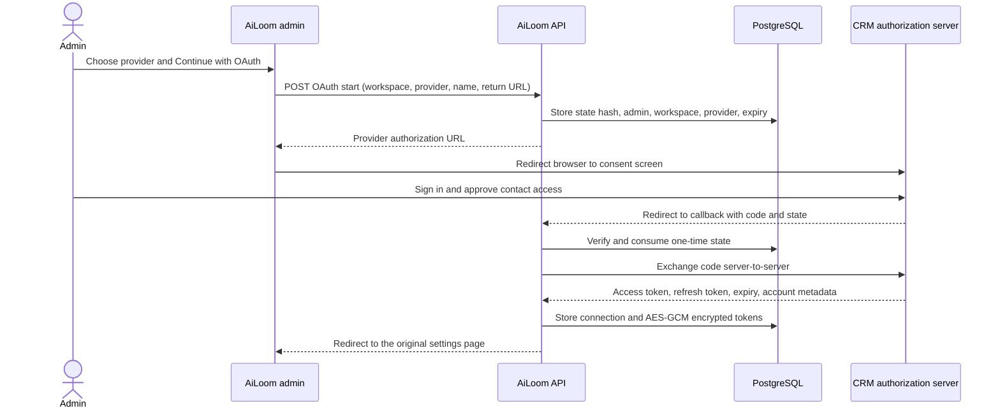
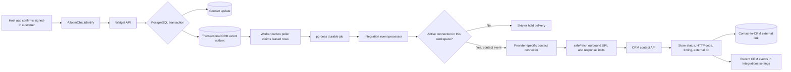
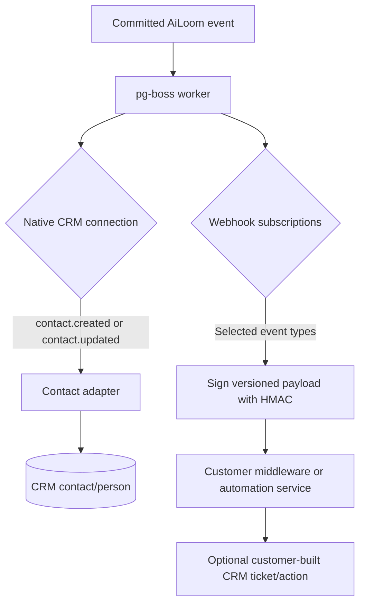

# CRM connections: setup and data flow

AiLoom's native CRM connectors currently send **contact identity updates out of AiLoom**. They
do not import CRM records, create tickets or cases, attach handoffs, or send conversation
transcripts. AiLoom remains the source of truth for its contacts and conversations. For other
event types, use the separate signed-webhook feature and build the CRM-specific action in your
receiver.

The provider matrix distinguishes offline contract coverage from live verification. At present,
the HubSpot contact write path has one recorded live delivery using a private service token; the
OAuth redirect path is implemented but has not been live-tested against a provider app.

## 1. Connect a CRM account

An instance operator first registers an OAuth app with the CRM provider and configures its
client ID and secret in the AiLoom instance's `CRM_OAUTH_CLIENTS` setting. The app's registered
callback URL must match this pattern exactly:

```text
https://support.example.com/v1/integrations/oauth/callback/<provider>
```

The admin then opens **Workspace → Settings → Integrations**, selects a provider, enters a
connection name and any required tenant URL, and chooses **Continue with OAuth**. The form's
scope field is an audit note for manually entered credentials; OAuth uses the connector's
least-privilege default scopes. Some provider apps also require the operator to configure those
permissions in the provider's developer console.



The callback does not trust a workspace ID or return URL from the provider. It uses a
cryptographically random state value, stores only its SHA-256 hash, expires it after ten minutes,
and consumes it once. The callback exchanges the code on the API server; the browser never
receives the access token, refresh token, or client secret. Provider client secrets stay in the
instance environment, and workspace tokens are encrypted at rest.

AiLoom supports the authorization-code flow for HubSpot, Salesforce, Dynamics 365, Zoho,
Pipedrive, Zendesk, and Intercom. Freshdesk currently uses its API-key flow. Private-app or
self-hosted token entry remains available in the form for providers that support it. A configured
OAuth client is required before its redirect button can start.

The callback records the integration as active. **Test connection** then makes a read/health
request to the provider. It proves the saved credential can reach the provider; it does not write
a contact. Access tokens with expiry and refresh tokens are refreshed server-side before they
expire. If refresh is rejected, the connection moves to **Reauthentication required**.

## 2. Send an identified contact update

The host application should identify a signed-in visitor through the widget API only after its
own authentication check:

```js
await AiloomChat.identify({
  externalId: currentUser.id,
  email: currentUser.email,
  name: currentUser.name,
});
```

AiLoom updates that workspace-scoped contact and writes a versioned `contact.updated` event in
the same PostgreSQL transaction. If the transaction rolls back, the event does too. Anonymous
`contact.created` events have no provider identity and are skipped by native connectors until the
visitor is identified.



The worker checks the transactional outbox about once per second, leases committed events, and
places them on **pg-boss**, which is backed by PostgreSQL. The worker processor loads the event,
selects active integrations belonging to that workspace, and invokes each provider adapter. The
adapter translates AiLoom's normalized identity into that provider's request, calls it through
`safeFetch`, and returns the CRM record ID. AiLoom stores the delivery result and, when it has
both AiLoom and provider IDs, a workspace-scoped mapping for the contact sidebar.

The native CRM payload is intentionally small: email and name, with a provider-specific source
ID only where supported. Contact attributes, messages, private agent notes, prompts, RAG source
chunks, traces, and model requests are not sent by these native connectors. Replayed events use
provider-specific matching/upsert behavior; see the provider matrix for each match strategy and
the limits of its idempotency guarantees.

## 3. Native CRM versus outbound webhooks

Native CRM delivery and signed webhooks consume the same transactional event stream, but they
are separate integrations. Native CRM adapters currently accept `contact.created` and
`contact.updated`. Webhooks can subscribe to the broader event set, including handoff and
conversation events, then translate those events into tickets, cases, or timeline activities in
an external automation or middleware service.



The native CRM adapter does not receive a handoff event today, even though that event exists in
AiLoom's outbox. A configured webhook can receive `handoff.requested`; your receiver can then
create a ticket or case through its own CRM integration. Webhook signatures must be verified
against the exact raw request body and timestamp.

## Delivery checks and limitations

- A successful **Test connection** is a provider read/health check, not a contact write.
- A **Delivered** event means the provider returned a successful HTTP response. AiLoom stores the
  returned CRM object ID, but does not read the record back to prove the provider persisted every
  field.
- `401`/`403` during CRM delivery require reauthorization; rate limits, timeouts, and provider
  server errors retry through pg-boss. Permanent provider rejections are recorded for inspection.
- **Recent CRM events** displays attempts, HTTP status, duration, sanitized error codes, and any
  returned object ID. It is separate from webhook delivery history.
- All eight providers currently have offline fake-transport contract tests. Only HubSpot has a
  recorded live contact delivery, and that smoke used a private service token rather than this
  OAuth redirect. A successful OAuth setup for one provider does not certify other providers.

## Implementation map

- [OAuth start and callback](../../apps/api/src/modules/integrations/integration-oauth.controller.ts)
- [OAuth state, code exchange, and token refresh](../../apps/api/src/modules/integrations/oauth-flow.service.ts)
- [Workspace connection and delivery lifecycle](../../apps/api/src/modules/integrations/integrations.service.ts)
- [Transactional outbox and job processor](../../apps/api/src/modules/integrations/outbox.service.ts)
- [Outbox polling and leasing](../../apps/api/src/modules/integrations/outbox-polling.service.ts)
- [Provider contract and registry](../../apps/api/src/modules/integrations/connectors/connector.ts)
- [Provider verification matrix](./crm-provider-matrix.md)
- [CRM live verification record](./crm-verification.md)
- [Widget identity API](../../apps/docs/src/content/docs/widget.md)
